# AVA DKong Jr

[](https://github.com/Harlock123/AVADKongJr/actions/workflows/build.yml)

A vine-climbing rescue game in the style of Nintendo's 1982 arcade game **Donkey Kong Jr.**, built with
.NET 10 and Avalonia UI. The Keeper has locked Papa, the big ape, in a cage. His son Kip climbs to the
rescue through a jungle of vines over the water, a hideout of live wires and sliding platforms, and a
wall of chains with the six keys to Papa's cage. The characters are this game's own, and Papa is the ape
from [AVAKong](https://github.com/Harlock123/AVAKong).

## Features

- **Climbing**:
  - **One vine or two:** with a hand on each of two vines, Kip climbs up quickly and slides down slowly. With one vine he climbs slowly and slides down fast.
  - **Changing vines:** press towards the vine beside him to take hold of both, and press again to let go with one hand. Letting go with one is how a Nipper on the other vine gets past him.
  - **Getting on and off:** he jumps to catch a vine, leaps from one vine to another, and climbs off the top onto the platform it hangs from.
  - **Falling:** slide off the bottom of a vine and he drops to whatever is below. That's fine if it's near, but a long fall, the water or the pit is the end of him.
- **Three stages to a level**:
  - **The Jungle:** start on the islands, climb up the vines and ledges to the key by Papa's cage. The Keeper sends Nippers along the top and down the vines. Red ones patrol up and down, and blue ones crawl down and drop off the bottom.
  - **The Hideout:** ride a sliding platform over the pit, climb a wire, and leap for the pair of wires that lead to the top. Sparks run up and down the wires, and Squawkers fly across dropping eggs.
  - **The Keys:** six chains, each with a key. Climb up under a key to push it up its chain into Papa's cage lock. Let go, and it slides back down. Lock all six and Papa is free. Red Nippers patrol the chains and Squawkers fly across.
  - **Going round again:** after the Keys the next level starts, faster and with a bigger bonus.
- **Fruit** hangs on the vines. Touch it and it drops, crushing every Nipper, Spark or bird in its way: 400 for the first, 800 for the next, then 1,200, and so on.
- **Scoring**:
  - **Jumping over things:** jump over a Nipper or a Spark on a platform for 100.
  - **The bonus:** it counts down by 100 every two seconds. Finish the stage to bank what's left. If it reaches nothing, Kip is lost.
  - **Keys:** 200 for each one locked.
  - **Extra life:** one at 10,000 and every 40,000 after that.
- **Sound**:
  - **The music:** a jaunty swing for the stages and a lazy jungle stroll for the title, both new.
  - **The effects:** jumps, grabs, the patter of climbing, the Keeper's whip, Sparks crackling, Squawkers, eggs, fruit dropping and landing, keys clicking into their locks, splashes and a fanfare for Papa's freedom.
  - All of it is synthesised and mixed by OpenAL.
- **Attract mode**: leave the title alone for 15 seconds and a computer Kip plays.
  - **Routes:** it knows a way up each stage and follows it from wherever it finds itself.
  - **Vines:** it holds a pair where it can and lets go of one to let a Nipper by. It waits for a vine to be clear before leaping, and won't climb out at the top into something walking past.
  - **Avoiding trouble:** it steps out from under eggs and jumps whatever comes along the platform.
- **A top-ten high-score table** with arcade-style initials entry. It records the level reached.
- **Gamepads** through SDL2, as well as the keyboard.
- **Any window size**: the screen scales to fit, letterboxed. **Ctrl+S** saves a screenshot.
- **One self-contained executable** per platform: Windows, macOS and Linux on Intel/AMD and ARM.

## Screenshots

| The title | The jungle | Climbing |
|:---------:|:----------:|:--------:|
| 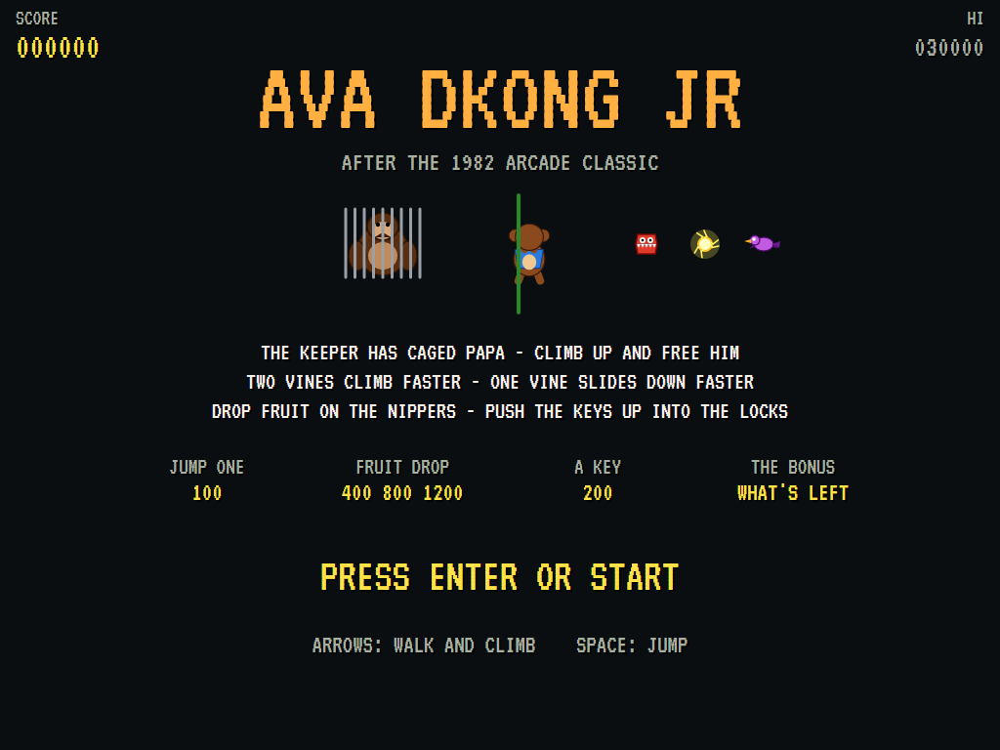 | 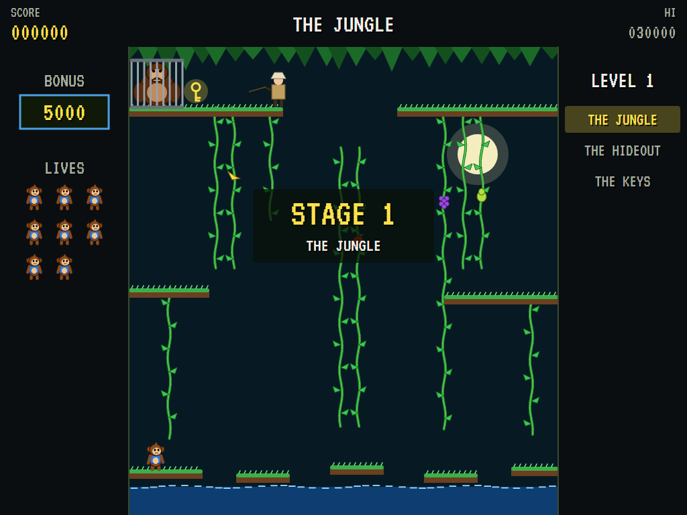 | 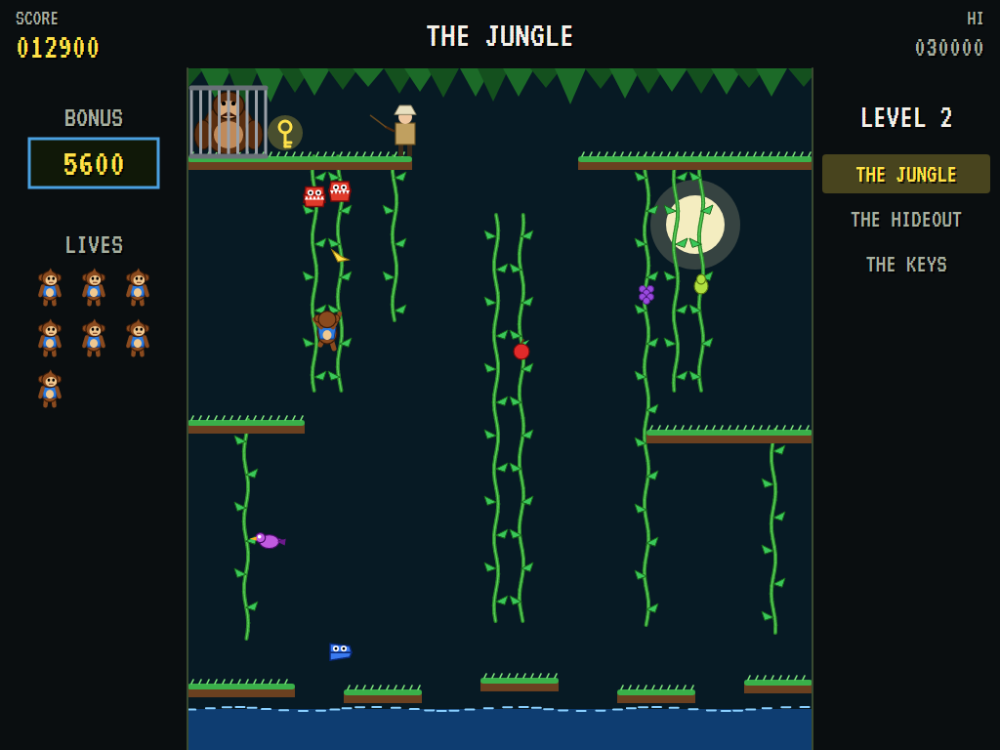 |
| Papa, Kip, and what's after him. | Vines over the water. | Nippers on the vines. |

| Fruit | The key | A splash |
|:-----:|:-------:|:--------:|
| 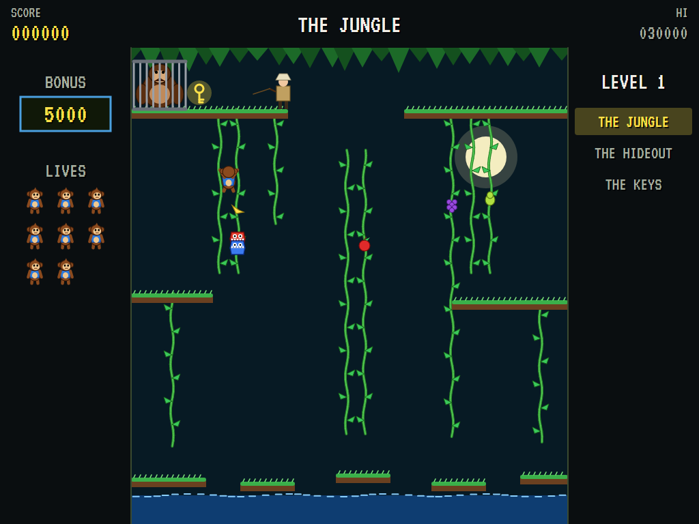 | 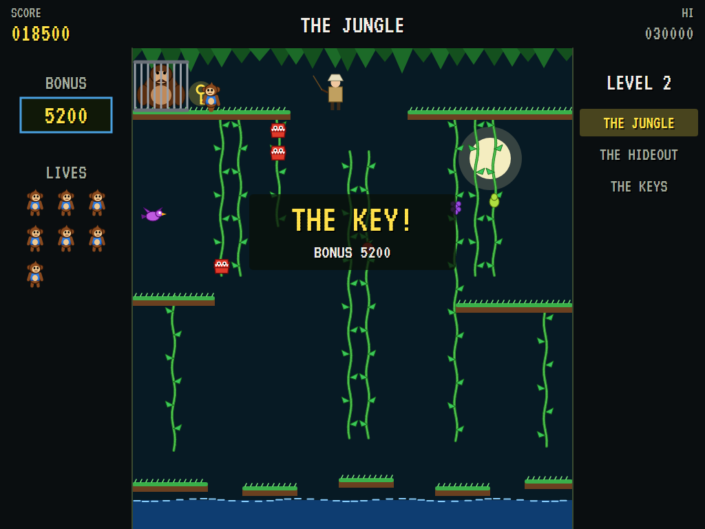 | 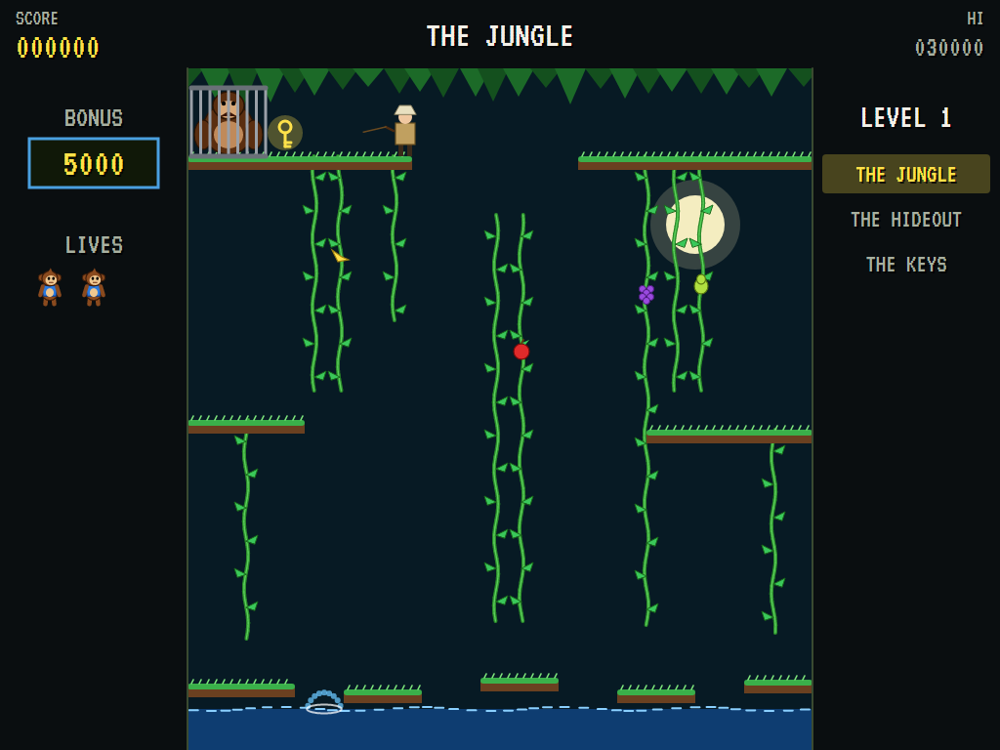 |
| Knocked loose onto two Nippers. | The bonus banked. | Into the water. |

| The hideout | The wires | The keys |
|:-----------:|:---------:|:--------:|
| 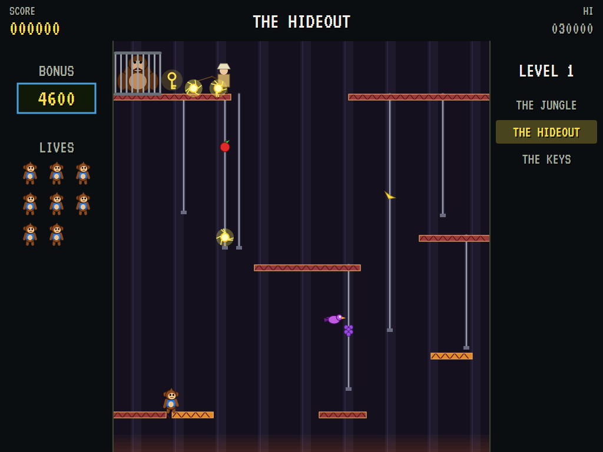 | 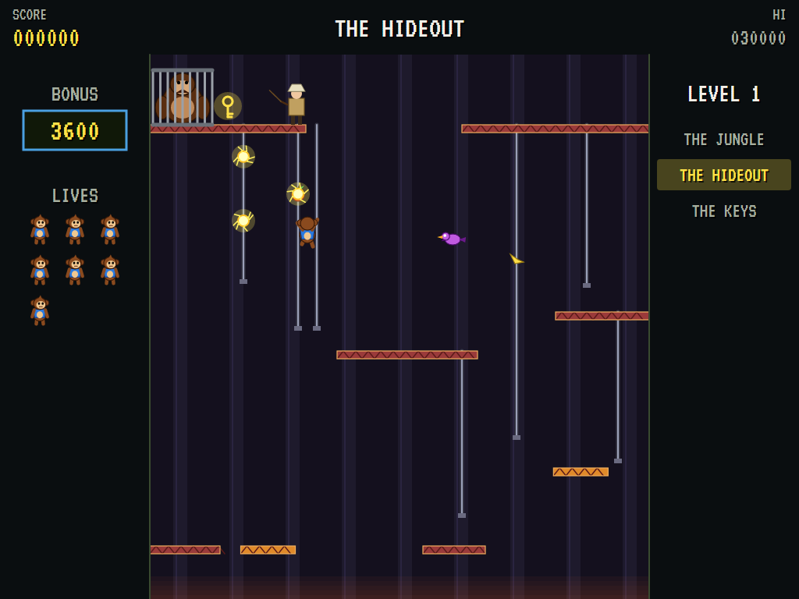 | 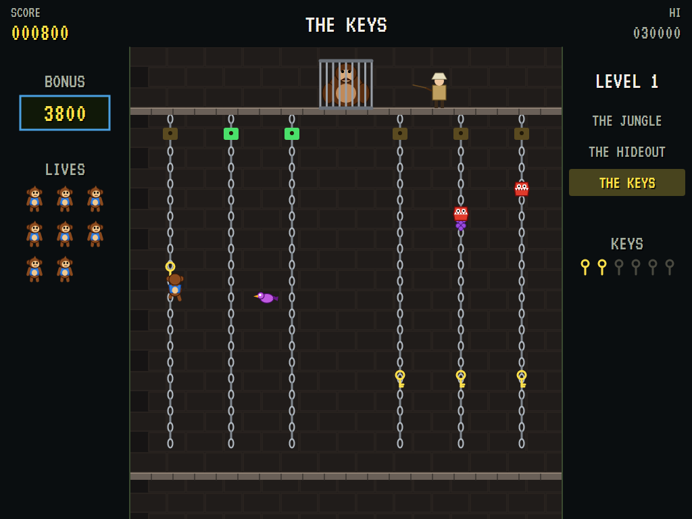 |
| Riding over the pit. | Sparks and a Squawker. | Pushing the keys up. |

| Papa is free | The top climbers | |
|:------------:|:----------------:|:-:|
| 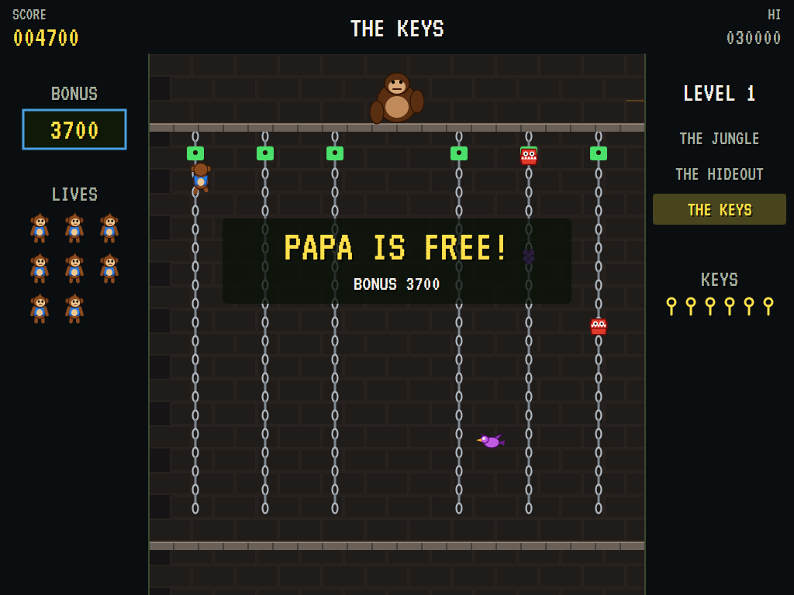 | 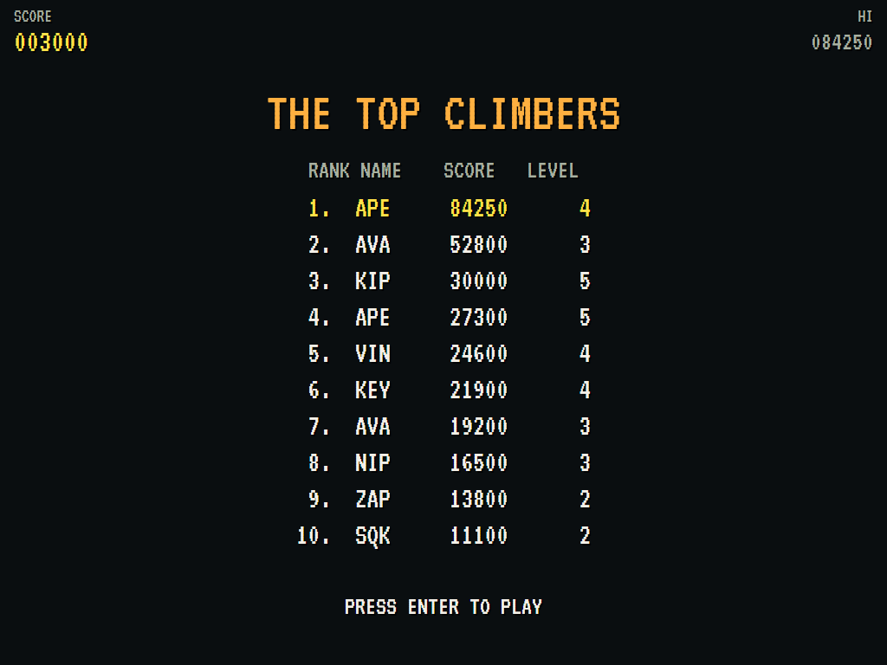 | |
| All six locked. | The high-score table. | |

The screenshots are made by the tests, which play the game in a real (headless) window; see
[Tests](#tests).

## Download and run

Ready-to-run builds for Windows, macOS and Linux, on both Intel/AMD and ARM, are on the
[Releases page](https://github.com/Harlock123/AVADKongJr/releases/tag/latest). **Latest build** is rebuilt
on every push to `main`. Each download is one self-contained executable: no .NET install is needed.

| Platform | Archive |
|---|---|
| Windows | `AVADKongJr-win-x64.zip`, `AVADKongJr-win-x86.zip`, `AVADKongJr-win-arm64.zip` |
| macOS | `AVADKongJr-osx-arm64.tar.gz` (Apple silicon), `AVADKongJr-osx-x64.tar.gz` (Intel) |
| Linux | `AVADKongJr-linux-x64.tar.gz`, `AVADKongJr-linux-arm64.tar.gz`, `AVADKongJr-linux-arm.tar.gz` |

```bash
tar -xzf AVADKongJr-linux-x64.tar.gz     # or linux-arm64, linux-arm, osx-arm64, osx-x64
./AVADKongJr
```

On Windows, unzip and run `AVADKongJr.exe`. On macOS, if Gatekeeper refuses to open it, run
`xattr -d com.apple.quarantine AVADKongJr` once. Run with `--no-audio` for silence.

**Sound** comes through OpenAL Soft, built in for every platform. In a virtual machine the game
detects it and uses a larger audio buffer, so the sound doesn't break up.

**Gamepads** use SDL2, which is bundled for Windows, macOS and Intel/AMD Linux. ARM Linux builds need it
installed; without it the keyboard still works:

```bash
sudo apt install libsdl2-dev            # Debian / Ubuntu / Raspberry Pi OS
sudo pacman -S --needed sdl2-compat     # Arch / Omarchy
```

## Controls

| Input | Action |
|-------|--------|
| **Enter** | Start |
| **Left** / **Right** (or **A** / **D**) | Walk; on a vine, take hold of the one beside (or let go of one of two) |
| **Up** / **Down** (or **W** / **S**) | Climb; **Up** under a vine takes hold of it |
| **Space** / **Z** / **X** / **Ctrl** | Jump (from a vine, leap the way you're pressing or facing) |
| **P** / **Esc** | Pause (Esc again to quit) |
| **M** | Mute |
| **Ctrl+S** / **Cmd+S** | Save a screenshot to the Pictures folder |

**Gamepad**: left stick or D-pad to walk and climb, **A**, **B** or **X** to jump, **Start** to start and
pause, **Back** (while paused) to quit.

**Entering initials**: type letters, or dial with **Up**/**Down** and accept with **Space**; **Left** /
**Backspace** go back; **Enter** finishes.

## Tests

```bash
dotnet test AVADKongJr.slnx
```

The engine has no UI and runs in fixed 60 Hz steps, so it plays the same at any frame rate, and a seed
always plays the same game. The tests check:

- **The stages:** the Jungle, the Hideout and the Keys in turn, then a faster level. Every stage gives the Keeper vines to send things down, and every vine ends where Kip can land below it.
- **Kip:**
  - walking, and walking off into the water
  - jumping
  - one hand and two climbing and sliding at their own speeds, taking hold of a second vine and letting go of one
  - climbing off the top, catching a vine with a jump and leaping between vines
  - sliding off onto the island below, the fatal long fall, and riding a sliding platform
- **Fruit, enemies and points:**
  - fruit crushing everything below it for more and more
  - jumping a Nipper for 100
  - red Nippers patrolling and blue ones dropping off
  - the Keeper sending them down his vines
  - Nippers, birds and eggs ending Kip, the stage starting again, and the last life ending the game
- **The goals:**
  - reaching the key and banking the bonus
  - the bonus running out
  - keys pushed up and sliding back, and locked for 200
  - the sixth freeing Papa and starting the next level
- **The machine:** an extra life, the computer Kip clearing the first stages, the attract cycle, the same game from the same seed, initials and the high-score file

The screenshot tests draw the real screen in a headless window. To refresh the README's pictures:

```bash
KONGJR_SHOTS=$PWD/Images dotnet test tests/AVADKongJr.Tests --filter ScreenshotTests
```

To see how the computer Kip gets on, stage by stage (for tuning):

```bash
KONGJR_PROBE=1 dotnet test tests/AVADKongJr.Tests --filter PilotProbe --logger "console;verbosity=detailed"
```

## Building

```bash
dotnet build AVADKongJr.slnx
dotnet run --project src/AVADKongJr
```

Needs the .NET 10 SDK. The sounds are made by `tools/make_sounds.py` (standard-library Python):
`python3 tools/make_sounds.py` rewrites `src/AVADKongJr/Sounds`.

## Project structure

```
AVADKongJr/
├── AVADKongJr.slnx
├── src/AVADKongJr/
│   ├── Engine/
│   │   ├── GameEngine.cs        # States, the title and demo cycle, and the music
│   │   ├── GameEngine.Play.cs   # Kip walking, jumping, climbing and falling; fruit, keys, the enemies,
│   │   │                        # the bonus, the stages and scoring
│   │   ├── Stage.cs             # The three stages' layouts: platforms, vines, wires and chains, fruit
│   │   ├── KidPilot.cs          # The computer Kip, for the demonstration (and the tests)
│   │   ├── Entities.cs
│   │   ├── HighScoreTable.cs, InitialsEntry.cs
│   │   ├── InputHandler.cs, ControllerManager.cs  # Keys and an SDL2 gamepad
│   │   └── SoundManager.cs      # Effects and the tunes through OpenAL
│   ├── Audio/                   # The OpenAL engine (from the author's AVABand)
│   ├── Views/                   # The stages, Kip, Papa and the Keeper, the enemies, the panels, the screens
│   └── Sounds/                  # The synthesised effects and tunes
├── tests/AVADKongJr.Tests/      # Gameplay, screenshot and probe tests
├── tools/make_sounds.py
└── Images/                      # Screenshots
```

## About and licence

AVA DKong Jr © 2026 Lonnie Watson, under the [MIT License](LICENSE).

*Donkey Kong Jr.* © 1982 Nintendo; the name belongs to its current owner. AVA DKong Jr is an independent,
unofficial game in its style. Kip, Papa, the Keeper, the Nippers, Sparks and Squawkers, its stages,
graphics, sounds, tunes and code are its own; nothing is taken from the arcade machine's program,
graphics, sound or music. It is not affiliated with or endorsed by any rights holder.
